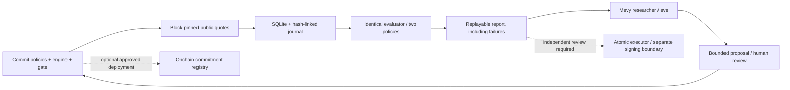

# Architecture

## What evolves

The first strategy family searches public WETH → USDG → WETH round trips across **different Uniswap v3 fee-tier pools** on Robinhood Chain (4663). A candidate can change size (at most 0.02 WETH), minimum edge and a decision gas buffer. It cannot introduce arbitrary code. This is deliberately narrower than autonomous strategy-code generation; arbitrary generated code needs a separate isolated review/fork pipeline before it can become a strategy family.

`src/robinhood.ts` verifies chain, deployed bytecode, factory/pool identity, fee and token pair, then calls QuoterV2 for a complete two-pool route at one block. Both policies receive the same observations. AMM fees are inside the quote. The economic gas model uses quoted gas plus 150,000 overhead, the pinned block base fee, and an operator-specified extra gas cost. The safety multiplier changes the admission decision, not the common economic cost charged to a trade.

Actual tips/L1 data fees, provider/infra costs and candidate LLM cost must be recorded explicitly in WETH wei. Conversion from a USD invoice must retain its source/FX basis in the experiment note. A zero needs an explanation. Missing cost is `null`, never an earned-profit claim. This is a model, not a guaranteed upper bound. In particular it does not price failed submissions or competition.

## State and replay

`Store` uses Node 24 SQLite, WAL, immediate transactions and primary keys for atomic freeze, observation and proposal records. Duplicate identical observations are idempotent; conflicting block records/reorgs fail. A restart retains data and the three-proposal cap. The journal binds table entries and detects missing/extra/tampered rows. Local owner tampering remains possible; see SECURITY.md.

An experiment binds baseline, candidate, exact evaluator source digest, acceptance policy, training cutoff, freeze block and cost assumptions. Export binds that experiment, sorted data and report in one bundle digest. `verify` recomputes all outputs without a model or private key. It verifies internal consistency; `audit-source` re-quotes the saved block against the public RPC separately.

Forward gate: at least 7 days, at least 1,000 observations, gaps no greater than 300 seconds, complete costs, adequate paired improvement and bounded modelled drawdown/loss. Passing only makes a candidate eligible for review. Live promotion is disabled. A new candidate needs a new freeze after **every** inspected training observation. The gate values are design choices, not a statistically proven alpha test. Repeated candidate selection still requires multiple-testing controls and fresh holdouts before a deployment decision.

`prepare-next` binds the proposal receipt, parent evidence bundle and the full current training cutoff into an approval draft. `freeze-next` accepts only that exact draft hash and rechecks the parent under a SQLite writer lock. Control and acceptance rules are copied unchanged; lineage is included in the successor's commitment. An extra parent observation invalidates the old approval. A policy that only renames unchanged economics is rejected.

## Runtime

The collector is a bounded read-only process (30–240 second cadence, at most 24 hours per invocation) with a single-writer lock. Provider failures stop visibly; restarting does not hide missing intervals. It does not run at install or on a schedule. The operator must authorize and provision continuous collection separately.

eve is the separate durable research layer, configured for direct OpenAI access. Only read_experiment and propose_candidate are exposed. The reader exposes complete totals and explicitly bounded pages of original route quotes, with `nextOffset`; it no longer silently limits inspection to the most recent20 ledger rows. The LLM remains outside the latency-sensitive execution path.

The separate one-shot `research:llm` command needs no HTTP server. It validates an exported bundle and its complete source receipt package, sends all supplied quotes in a dictionary-compressed packet and validates a structured no-change result or a single-field policy draft. Oversized contexts fail before a request rather than being truncated. The reserve is recorded before the only request, automatic client retries are disabled, and failures/unknown cost remain visible. The draft is not an approved database proposal. Token budgets, provenance and human approval do not substitute for actual invoice reconciliation. One actual direct OpenAI analysis of the complete archive-checked40-row snapshot is recorded in the verification ledger. It returned NO_CHANGE. An offline request-wiring test is still separate from that real provider response, and neither establishes a useful profitable improvement cycle.

## Onchain boundary

ExperimentRegistry is a recorder-owned, immutable commitment/result registry. It enforces uniqueness, recorder authorization, ordering, seven elapsed days and a declared observation count. That count is attested by the recorder, not proven onchain. It has no custody, profit oracle, token or payout function.

Unsigned onchain preparation binds a domain-separated ID, exact experiment/result digests and registry runtime/recorder identity. Creation-receipt verification compares actual deployment input with the source-bound compiled artifact. A result transaction requires observations after the actual public anchor and a full evidence duration measured from that anchor, in addition to the local research gate. No signing or broadcast capability is added. Bundled deployment artifacts are rebuilt and compared in CI.

AtomicRoundTrip supports one fixed asset/quote/factory/router family, two distinct pools, maximum size, nonce, a short deadline, an absolute gain floor and actual before/after WETH balances. It resets approvals. Its balance gain excludes gas. Tests cover local invariants; public deployment, independent audit and a real signed canary are separate gates. This does not connect to or replace the inaccessible old searcher.
